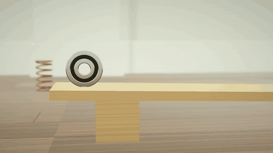
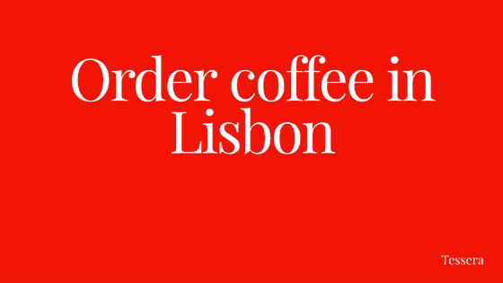

# leo-adopus

**50 legendary ads, remade in code — for your product.**

`Ad + Opus` — a magnum opus for your ad.

[中文](README.zh-CN.md)

<p>
  
  
  
</p>
<p>
  
  
  
  
</p>

Every film above was made from a short brief, entirely in code, with an
original soundtrack composed in code.

| Style | Inspired by | Demos |
|---|---|---|
| [Silhouette dancers](styles/silhouette-dancers/STYLE.md) | Apple iPod "Silhouettes" (2003) | [earbuds, 16:9](docs/demos/silhouette-dancers.mp4) · [bottle, 9:16](docs/demos/flow-bottle.mp4) |
| [Year-in-review cards](styles/year-in-review/STYLE.md) | Spotify Wrapped (2016–) | [coffee app, 9:16](docs/demos/brewly-year.mp4) |
| [Search box story](styles/search-box-story/STYLE.md) | Google "Parisian Love" (2009) | [writing app, 16:9](docs/demos/inkwell-search.mp4) |
| [Parts chain reaction](styles/chain-reaction/STYLE.md) | Honda "Cog" (2003) | [speaker, 16:9](docs/demos/orrin-speaker.mp4) |
| [Whitespace self-deprecation](styles/whitespace-humble/STYLE.md) | Volkswagen "Think Small" (1959) | [kettle, 4:5](docs/demos/pip-kettle.mp4) · [poster](docs/demos/pip-kettle-poster.jpg) |
| [Red poster wit](styles/red-poster-wit/STYLE.md) | The Economist red posters (1988–) | [language app, 16:9](docs/demos/tessera-posters.mp4) |

> 🚧 6 of 50 styles render today. The rest are planned in the
> [style index](styles/README.md). Star the repo to follow along.

## Use it in Claude Code

```text
/plugin install leo-adopus --marketplace lin2998145012-code/leo-adopus
```

Or, on older versions:

```text
/plugin marketplace add lin2998145012-code/leo-adopus
/plugin install leo-adopus@leo-adopus
```

Then ask for an ad:

```text
Make a 15-second vertical silhouette-dancers ad for my energy drink ZING.
The can is ./can.png. Tagline: "Feel the beat."
```

```text
Make a year-in-review video for my app Inkwell: 48,200 new writers,
1.2M notes, top features Search, Sync, Templates, Tags and Share.
```

```text
Make a search-box-story ad for Inkwell, a notes app for writers: someone
who dreams of a novel finds Inkwell and ends up writing the dedication.
```

```text
Make a chain-reaction ad for my speaker Orrin (./speaker.png, 36 cm tall),
tagline "Every part, in tune."
```

```text
Make a Think-Small-style print ad and video for my kettle Pip (./kettle.png).
It only holds two cups; make that the point.
```

```text
Make red-poster-wit posters for Tessera, a language app: four witty lines
about its users, as a video and as stills.
```

Claude checks your machine, asks for anything missing, shows you a
storyboard, then renders the MP4. You can also run the skill directly with
`/leo-adopus:make-ad`.

## Use it from the command line

You need Node 22+, ffmpeg and Google Chrome. There is nothing to
`npm install`.

```sh
git clone https://github.com/lin2998145012-code/leo-adopus
cd leo-adopus
node core/cli.mjs doctor          # checks Node, ffmpeg and Chrome

node core/cli.mjs new ../my-ad --name ZING --tagline "Feel the beat." \
  --product ../can.png --size 0.12 --line none --aspect 9:16
node core/cli.mjs preview ../my-ad   # one frame per shot → my-ad/out/storyboard.png
node core/cli.mjs render ../my-ad    # → my-ad/out/my-ad.mp4
```

| Option | What it sets |
|---|---|
| `--name`, `--tagline` | End card text |
| `--product` | Your product as a PNG with a transparent background, or an SVG. It is drawn as a white silhouette. |
| `--size` | The product's height in meters when held (0.09 player, 0.12 can, 0.15 phone, 0.22 bottle) |
| `--line` | `earbuds` for a Y-shaped earbud wire, or `none` |
| `--length` | Seconds; cuts follow the beat |
| `--aspect` | `16:9`, `9:16`, `1:1` or `4:5` |
| `--music`, `--bpm` | Your own track and its tempo. Without it, an original track is composed. |
| `--palette` | Background colors: `lime,pink,cyan,yellow,orange,violet` or hex values |

These are the silhouette-dancers options. For a year in review:

```sh
node core/cli.mjs new ../my-year --style year-in-review --name Inkwell \
  --url inkwell.so --logo ../logo.svg --year 2026
# fill in the cards in my-year/brief.json, then preview and render
```

And a chain reaction:

```sh
node core/cli.mjs new ../my-chain --style chain-reaction --name Orrin \
  --product ../speaker.png --size 0.36 --tagline "Every part, in tune."
```

```text
Make a Think-Small-style print ad and video for my kettle Pip (./kettle.png).
It only holds two cups; make that the point.
```

```text
Make red-poster-wit posters for Tessera, a language app: four witty lines
about its users, as a video and as stills.
```

Everything ends up in the film's `brief.json`, which you can edit by hand,
down to every shot or card. Each style file has a Brief section with the
full format.

## How it works

- A **style** is a [`STYLE.md`](styles/silhouette-dancers/STYLE.md) (what to
  keep, what to replace, shot list, pitfalls) plus a **kit**: an HTML page
  that draws any frame of a film from a brief.
- `core/cli.mjs` opens the kit in headless Chrome over the DevTools protocol,
  captures every frame and encodes it with ffmpeg, together with music
  composed by the kit from the same shot plan.
- The silhouette kit drives dancers with motion capture, draws their bodies
  as a smooth union of capsules in a WebGL shader, and simulates hair,
  cloth and the wire at 240 Hz.
- The year-in-review kit draws story cards with canvas 2D: counting
  numbers, number walls, top-5 lists, popping shapes and iridescent ribbons.
- The search-box-story kit draws a search page and types into it with a
  human rhythm, with autocomplete, special results, a pointer and a camera,
  over a piano score and keyboard clicks.
- The chain-reaction kit builds a room and machined parts in 3D with
  three.js, simulates every roll, fall, bounce and swing, follows them with
  one unbroken dolly shot, and turns each collision into sound.
- The whitespace-humble kit sets a black-and-white magazine page — a small
  product in a vast gray photograph, a headline, three columns of copy —
  and films it being read, ending on the finished page.
- The red-poster-wit kit sets one line of white serif on red at the largest
  size that fits, in even lines, and cuts a run of posters on the beat,
  each punchline landing a beat after its setup.

```text
.claude-plugin/        plugin and marketplace manifests
skills/make-ad/        the skill Claude follows
core/                  CLI, Chrome driver, synthesizer, motion-capture tools
styles/<slug>/         STYLE.md, and kit/ when the style renders
examples/              the briefs behind the demos
assets/fonts/          Inter, DM Sans, Arimo, Libre Baskerville, Jost,
                       Playfair Display (SIL OFL)
assets/vendor/three/   three.js (MIT), used by the 3D kits
```

## Look-alike rules

Every style aims to be recognizable at first glance. Recognition comes from
technique, so that is what we keep:

| Keep — the technique | Replace — the assets |
|---|---|
| Composition and camera language | Original footage and frames |
| Color system | Original music and sound |
| Pacing and edit rhythm | Original copy, word for word |
| Copy structure | Brand names, logos and products |
| The signature move | Real people's likenesses |

Each style file lists exactly what it keeps and what it replaces. Use only
product images, logos and music you own.

## Disclaimer

The original ads are named only as inspiration and homage. This project is not
affiliated with, sponsored by or endorsed by any brand, agency or festival
mentioned here. All trademarks belong to their owners. Everything in this
repository — code, styles, music and demos — is original work.

## Credits and license

Code is released under the [MIT License](LICENSE). Demo films are released
under CC BY 4.0. The [Inter](assets/fonts/inter/OFL.txt),
[DM Sans](assets/fonts/dm-sans/OFL.txt), [Arimo](assets/fonts/arimo/OFL.txt),
[Libre Baskerville](assets/fonts/libre-baskerville/OFL.txt),
[Jost](assets/fonts/jost/OFL.txt) and
[Playfair Display](assets/fonts/playfair-display/OFL.txt) fonts are
under the SIL Open Font License. [three.js](assets/vendor/three/LICENSE) is
under the MIT License.

Motion data: the data used in this project was obtained from
[mocap.cs.cmu.edu](http://mocap.cs.cmu.edu). The database was created with
funding from NSF EIA-0196217.
