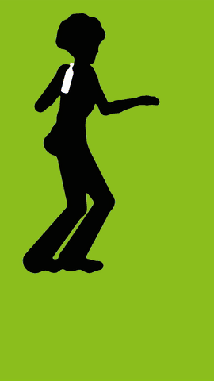
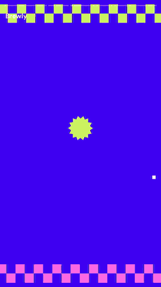
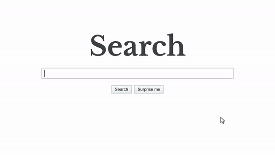

# leo-adopus

**50 支传奇广告，用代码为你的产品重拍。**

`Ad + Opus`：为你的广告做一部巅峰之作。

[English](README.md)

<p>
  
  
  
</p>
<p>
  
</p>

上面每支片子都只用一份简短的 brief、完全由代码生成，配乐也由代码原创合成。

| 风格 | 灵感来源 | Demo |
|---|---|---|
| [剪影舞者](styles/silhouette-dancers/STYLE.md) | Apple iPod "Silhouettes"（2003） | [耳机，16:9](docs/demos/silhouette-dancers.mp4) · [水瓶，9:16](docs/demos/flow-bottle.mp4) |
| [年度回顾卡片](styles/year-in-review/STYLE.md) | Spotify Wrapped（2016–） | [咖啡 App，9:16](docs/demos/brewly-year.mp4) |
| [搜索框里的故事](styles/search-box-story/STYLE.md) | Google "Parisian Love"（2009） | [写作 App，16:9](docs/demos/inkwell-search.mp4) |

> 🚧 目前 50 个风格中有 3 个可以渲染，其余见[风格索引](styles/README.md)。点个 Star 关注进展。

## 在 Claude Code 里使用

```text
/plugin install leo-adopus --marketplace lin2998145012-code/leo-adopus
```

较旧的版本用：

```text
/plugin marketplace add lin2998145012-code/leo-adopus
/plugin install leo-adopus@leo-adopus
```

然后直接提需求：

```text
给我的能量饮料 ZING 做一支 15 秒竖屏剪影舞者广告，罐子图片是 ./can.png，口号 "Feel the beat."
```

```text
给我的 App Inkwell 做一支年度回顾视频：新增 48,200 位作者、120 万条笔记，最受欢迎的功能是搜索、同步、模板、标签和分享。
```

```text
给写作笔记 App Inkwell 做一支"搜索框里的故事"广告：一个想写小说的人发现了 Inkwell，最后写下了书的献词。
```

Claude 会先检查环境，问清缺少的信息，给你看分镜，再渲染出 MP4。也可以直接运行 `/leo-adopus:make-ad`。

## 在命令行里使用

需要 Node 22+、ffmpeg 和 Google Chrome，不需要 `npm install`。

```sh
git clone https://github.com/lin2998145012-code/leo-adopus
cd leo-adopus
node core/cli.mjs doctor          # 检查 Node、ffmpeg 和 Chrome

node core/cli.mjs new ../my-ad --name ZING --tagline "Feel the beat." \
  --product ../can.png --size 0.12 --line none --aspect 9:16
node core/cli.mjs preview ../my-ad   # 每个镜头一帧 → my-ad/out/storyboard.png
node core/cli.mjs render ../my-ad    # → my-ad/out/my-ad.mp4
```

| 参数 | 作用 |
|---|---|
| `--name`、`--tagline` | 结尾卡片上的文字 |
| `--product` | 产品图：透明背景的 PNG 或 SVG，会被画成白色剪影 |
| `--size` | 产品拿在手里时的高度（米）：播放器 0.09、易拉罐 0.12、手机 0.15、水瓶 0.22 |
| `--line` | `earbuds` 为 Y 形耳机线，`none` 为不要线 |
| `--length` | 时长（秒），镜头按节拍切换 |
| `--aspect` | `16:9`、`9:16`、`1:1` 或 `4:5` |
| `--music`、`--bpm` | 你自己的音乐和它的速度；不提供时自动合成原创配乐 |
| `--palette` | 背景色：`lime,pink,cyan,yellow,orange,violet` 或十六进制色值 |

以上是剪影舞者的参数。年度回顾这样开始：

```sh
node core/cli.mjs new ../my-year --style year-in-review --name Inkwell \
  --url inkwell.so --logo ../logo.svg --year 2026
# 在 my-year/brief.json 里填好每张卡片的数据和文案，再预览、渲染
```

所有设置都写在影片文件夹的 `brief.json` 里，可以手动修改，细到每一个镜头或卡片。每个风格文件的 Brief 一节有完整格式。

## 工作方式

- 一个**风格** = 一份 [`STYLE.md`](styles/silhouette-dancers/STYLE.md)（保留什么、替换什么、分镜、常见坑）+ 一个 **kit**：根据 brief 画出影片任意一帧的 HTML 页面。
- `core/cli.mjs` 通过 DevTools 协议在无头 Chrome 里打开 kit，逐帧截取并用 ffmpeg 编码，配乐由 kit 按同一份镜头计划合成。
- 剪影 kit 用动作捕捉驱动舞者，用 WebGL 着色器把身体画成平滑融合的胶囊体，并以 240 Hz 模拟头发、布料和耳机线。
- 年度回顾 kit 用 canvas 2D 绘制故事卡片：数字滚动、数字墙、Top 5 榜单、弹跳图形和炫彩飘带。
- 搜索框故事 kit 绘制一个搜索页，用真人般的节奏打字，配合自动补全、特殊结果、鼠标指针和镜头运动，底下是钢琴配乐和键盘声。

## "像"的规则

每个风格的目标都是让人一眼认出原作。识别度来自手法，所以我们保留手法：

| 保留：手法 | 替换：素材 |
|---|---|
| 构图和镜头语言 | 原片画面 |
| 配色体系 | 原曲和音效 |
| 节奏和剪辑 | 原文案原句 |
| 文案结构 | 品牌名、logo 和原产品 |
| 标志性动作 | 真人肖像 |

每个风格文件都会写明具体保留什么、替换什么。只使用你自己拥有的产品图、logo 和音乐。

## 声明

原作广告仅作为灵感来源和致敬对象提及。本项目与文中提到的任何品牌、广告公司或广告节均无关联，也未获得其赞助或认可。所有商标归其各自所有者。本仓库中的代码、风格、音乐和 demo 均为原创。

## 致谢与许可

代码采用 [MIT 许可](LICENSE)，demo 影片以 CC BY 4.0 发布，[Inter](assets/fonts/inter/OFL.txt)、[DM Sans](assets/fonts/dm-sans/OFL.txt)、[Arimo](assets/fonts/arimo/OFL.txt) 和 [Libre Baskerville](assets/fonts/libre-baskerville/OFL.txt) 字体采用 SIL Open Font License。

动作数据来自 [mocap.cs.cmu.edu](http://mocap.cs.cmu.edu)，该数据库由 NSF EIA-0196217 资助创建。
